**章節導覽**：1 專案概述與環境建置　2 可執行連結　3 系統架構與資料流　4 功能說明與測試案例分析　5 PSNR 公式與濾波效果評估　6 AI 協作與 Prompt 歷程　7 結論與已知限制　參考資料

# 1　專案概述與環境建置

## 1.1　專案目標

本專案以 **Python 3.12 + Streamlit** 開發一個互動式影像處理與人臉分析工具，涵蓋四大功能：

| 功能 | 內容 |
|:----|:------------------------------------------------|
| 功能 1　影像載入與解析 | 支援 PNG、JPG/JPEG、BMP；即時預覽並顯示解析度、色彩維度、檔案大小等中繼資訊 |
| 功能 2　色彩空間與同步直方圖 | Original、RGB 分量、YUV（BT.601）分量三種檢視；切換時直方圖（橫軸 0–255、縱軸像素數）同步更新 |
| 功能 3　自訂卷積濾波與 PSNR | 使用者輸入奇數方陣核（3×3、5×5…）、可選正規化；濾波前後並排對照；即時計算 PSNR（dB） |
| 功能 4　人臉偵測 | OpenCV Haar-Cascade，標記所有人臉邊界框，顯示人臉總數與每張臉的信心度 |

## 1.2　開發環境

| 項目 | 版本／說明 |
|:--------|:------------------------------|
| 語言與執行環境 | Python 3.12 |
| 套件管理 | uv（`pyproject.toml` ＋ `uv.lock`），部署用 `requirements.txt` 由 `uv export` 產生 |
| 介面 | Streamlit 1.67 |
| 數值運算 | NumPy 2.5（卷積、色彩轉換、PSNR 皆以 NumPy 實作） |
| 影像解碼 | Pillow 13 |
| 人臉偵測 | opencv-python-headless 4.14（**必須為 4.x**，5.x 已移除 Haar-Cascade） |
| 繪圖 | Matplotlib 3.11 |
| 測試 | pytest、ruff |

## 1.3　安裝與執行

```
git clone https://github.com/koraqq/DIP-mid
cd DIP-mid
uv sync
uv run streamlit run app.py
```

不使用 uv 時：建立虛擬環境後執行 `pip install -r requirements.txt`，再執行 `streamlit run app.py`。部署所需的系統套件（中文字型 `fonts-noto-cjk`）列於 `packages.txt`。

## 1.4　專案結構

```
DIP-mid/
├── app.py                 Streamlit 進入點（四個分頁）
├── imagelab/
│   ├── io/                loader.py、metadata.py
│   ├── color/             channels.py、yuv.py
│   ├── analysis/          histogram.py
│   ├── filtering/         kernels.py、convolution.py、metrics.py
│   ├── validation/        matrix_parser.py、guards.py
│   ├── detection/         haar_detector.py、draw.py、base.py
│   └── ui/                sidebar、tab_overview、tab_color、tab_filter、tab_face、state
├── tests/                 pytest 單元測試（含邊界條件）
├── docs/                  psnr.md、convolution.md、report/（本報告）、images/
├── prompt_log/            AI 協作完整紀錄
├── requirements.txt、packages.txt、pyproject.toml、uv.lock
```

# 2　可執行連結

本專案以 Streamlit Community Cloud 作為線上即時展示，不另提供 Colab。

| 項目 | 連結 |
|:------------|:------------------------------------------------|
| 線上展示（Streamlit Cloud，Public） | https://dip-mid-tb8vrujcpzjqkwkc5onscz.streamlit.app/ |
| 原始碼（GitHub，Public） | https://github.com/koraqq/DIP-mid |

# 3　系統架構與資料流

## 3.1　分層架構

專案採「**介面層與演算法層分離**」：`imagelab/ui/` 只負責呈現與互動，所有影像處理邏輯放在不依賴 Streamlit 的演算法層，因此每個模組都能單獨以 pytest 測試，也能在 Colab 等其他環境重複使用。

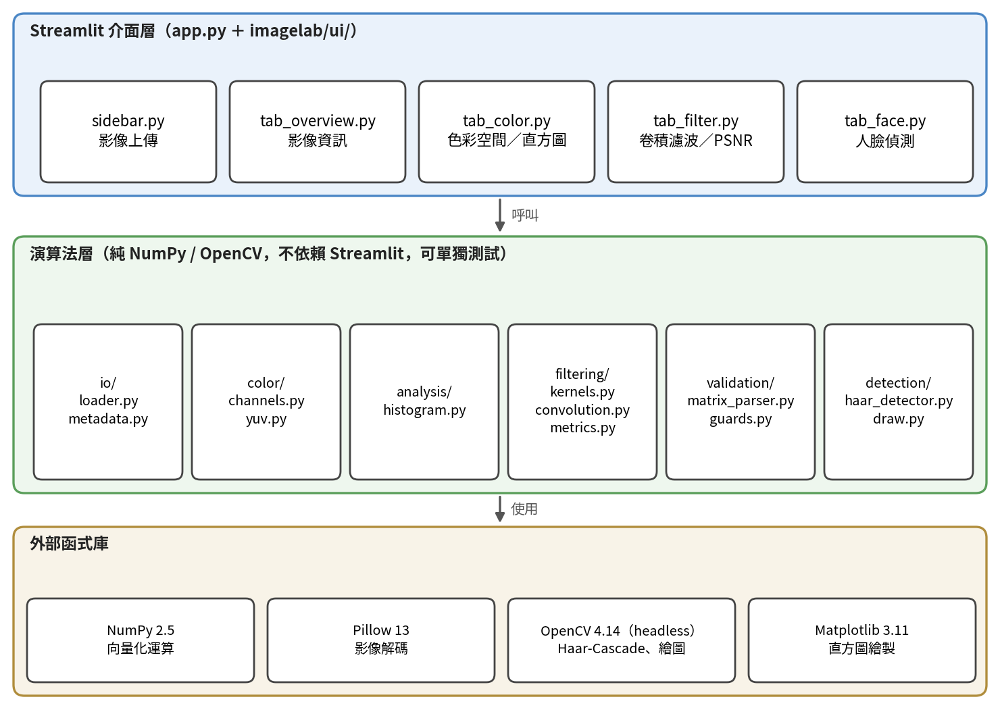{width=15cm}

## 3.2　資料流

使用者上傳的檔案先由 `load_image()` 統一解碼為 **RGB、uint8、(H, W, 3)** 的 NumPy 陣列，之後四個分頁共用這份資料。解碼結果以 `st.cache_data` 快取，切換分頁或調整參數時不需重新解碼；濾波與人臉偵測也各有快取，參數不變就不重算。

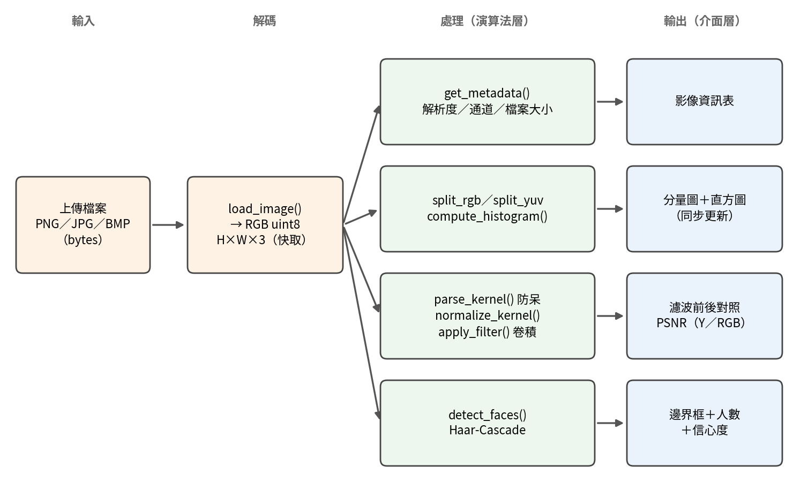{width=15cm}

## 3.3　模組職責

| 模組 | 職責 | 設計重點 |
|:----------|:------------------------|:------------------------------------|
| io | 影像解碼與中繼資訊 | 依檔案**內容**（非副檔名）判斷格式；套用 EXIF 方向；透明背景合成白底；拒絕過大影像（> 2500 萬像素） |
| color | RGB 分離、YUV 轉換 | BT.601 全範圍；轉換矩陣寫於檔案註解 |
| analysis | 直方圖計算與繪圖 | 橫軸 0–255、縱軸像素數；自動偵測中文字型，偵測不到時標題改英文 |
| filtering | 核、卷積、PSNR | 卷積以 NumPy 向量化實作；先轉 float64 再相減，避免 uint8 溢位 |
| validation | 輸入防呆 | 指出出錯的列與格；提供可顯示的中文錯誤訊息 |
| detection | Haar 偵測與繪圖 | 超大圖先縮小再偵測；對分類器加鎖以支援多人同時連線 |

# 4　功能說明與測試案例分析

測試影像為一張 800×533 的 JPEG 照片（含一張清晰人臉與兩張失焦人臉）。本影像僅供本課程作業之非營利教學與展示用途，不作任何商業使用；作業繳交後儲存庫將改為私人。

## 4.1　功能 1：影像載入與基礎解析

上傳後即時預覽，並以表格顯示檔名、格式、解析度、像素總數、原始色彩模式、通道數與檔案大小（圖 3：本例為 JPEG、800×533、426,400 像素、RGB 三通道、46.52 KB）。

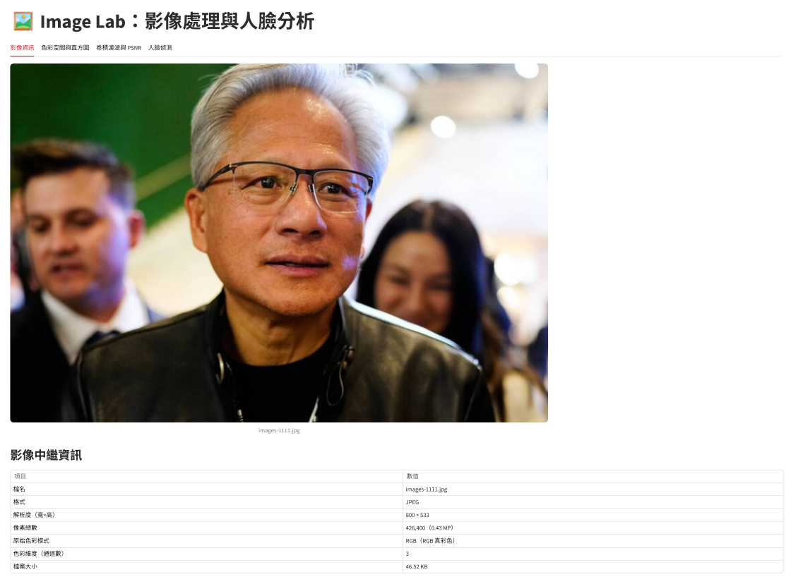{width=13cm}

**測試案例（邊界條件）**

| 測試案例 | 預期行為 | 對應單元測試 |
|:----------------|:--------------------------|:--------------------------|
| PNG、BMP 編碼後再解碼 | 與原陣列逐元素相同（無損） | `test_lossless_formats_roundtrip` |
| JPEG | 以 (H, W, 3) 的 RGB 載入 | `test_jpeg_loads_as_rgb` |
| 灰階 PNG | 自動擴為三通道，三個通道值相同 | `test_grayscale_png_becomes_three_channels` |
| 含透明通道的 PNG | 合成在白色背景上（全透明 → 全白） | `test_rgba_composited_on_white` |
| 空檔案、內容損毀 | 顯示友善錯誤訊息，程式不當機 | `test_empty_and_garbage_raise_friendly_error` |
| 不支援的格式（GIF） | 提示不支援並說明可用格式 | `test_unsupported_format_rejected` |
| 超過 2500 萬像素 | 提示影像過大 | `test_too_large_rejected` |

## 4.2　功能 2：色彩空間轉換與同步直方圖

**RGB 通道分離**：直接取 $R$、$G$、$B$ 三個 2D 陣列，可選「著色」（只保留該通道、其餘為 0）或「灰階」顯示。

**YUV 轉換**（BT.601 全範圍，U = Cb、V = Cr）：

$$\begin{bmatrix}Y\\U\\V\end{bmatrix}=\begin{bmatrix}0.299&0.587&0.114\\-0.168736&-0.331264&0.5\\0.5&-0.418688&-0.081312\end{bmatrix}\begin{bmatrix}R\\G\\B\end{bmatrix}+\begin{bmatrix}0\\128\\128\end{bmatrix}$$

反轉換為 $R=Y+1.402(V-128)$、$G=Y-0.344136(U-128)-0.714136(V-128)$、$B=Y+1.772(U-128)$。

**同步直方圖**：每個顯示模式下，影像與其對應通道的直方圖在同一次繪製中由同一份資料計算：Original 顯示灰階（亮度）與 RGB 疊圖直方圖；RGB 模式顯示 R、G、B 各自的影像與直方圖；YUV 模式顯示 Y、U、V 各自的影像與直方圖。因此切換模式時，影像與直方圖不可能不同步。

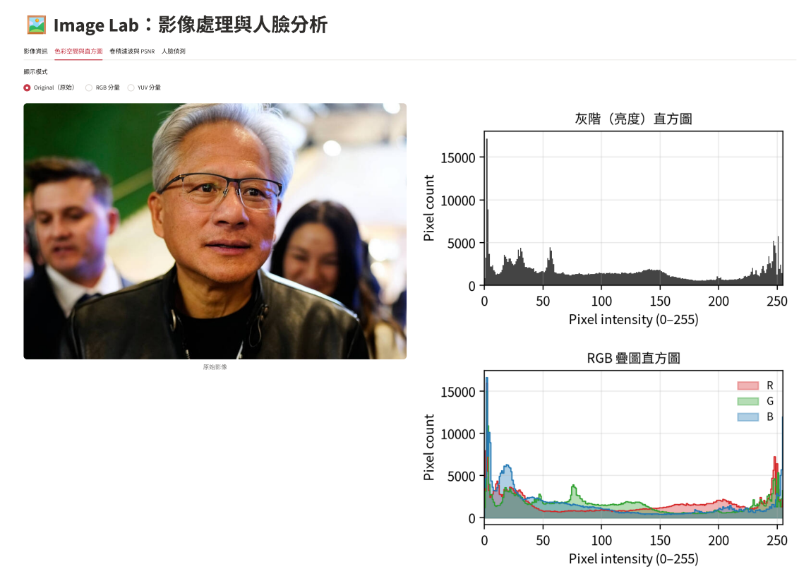{width=13cm}

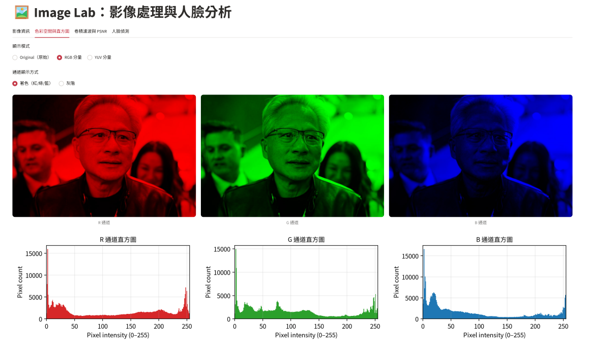{width=13cm}

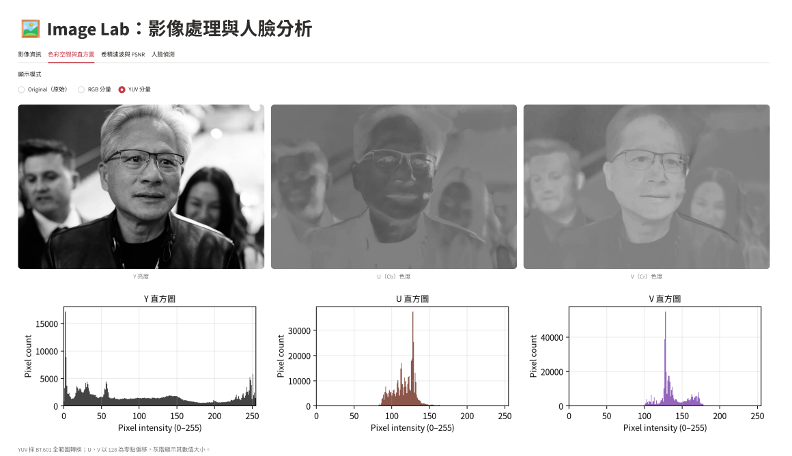{width=13cm}

**觀察**：本例的 U、V 直方圖都集中在 128 附近、範圍很窄，所以 U、V 分量圖看起來偏灰、對比低；這是因為多數像素色彩飽和度不高，色度偏離中性（128）的程度小。Y 分量則涵蓋整個亮度範圍，與灰階影像相同。

**測試案例**

| 測試案例 | 預期行為 | 對應單元測試 |
|:----------------|:--------------------------|:--------------------------|
| 灰階像素 (R=G=B=90) | Y = 90、U = V = 128（無色度） | `test_gray_pixels_have_neutral_chroma` |
| 純紅 (255, 0, 0) | (Y, U, V) = (76, 85, 255) | `test_known_primaries` |
| RGB → YUV → RGB 往返 | 每個通道誤差 ≤ 3 | `test_roundtrip_error_small` |
| 直方圖總和 | 長度 256，總和等於像素數 | `test_histogram_length_and_total` |
| 非 uint8 輸入 | 拒絕並報錯 | `test_rejects_non_uint8` |
| 系統沒有中文字型 | 圖表標題退回英文，不出現方框 | `test_title_falls_back_to_english_without_cjk_font` |

## 4.3　功能 3：自訂卷積核空間濾波與 PSNR

### 4.3.1　卷積定義與實作

核 $K$ 為 $k\times k$（$k$ 為奇數），中心偏移 $c=\lfloor k/2\rfloor$，**卷積**定義為：

$$\mathrm{out}[i,j]=\sum_{m=0}^{k-1}\sum_{n=0}^{k-1}K[m,n]\;x[\,i-m+c,\;j-n+c\,]$$

令補邊後的影像為 $P$（四邊各補 $c$ 格，$P[a,b]=x[a-c,\,b-c]$），並令 $u=k-1-m$、$v=k-1-n$，則 $x[i-m+c,\,j-n+c]=P[\,i+u,\;j+v\,]$，因此

$$\mathrm{out}[i,j]=\sum_{u}\sum_{v}K'[u,v]\;P[i+u,\;j+v],\qquad K'[u,v]=K[k-1-u,\;k-1-v]$$

也就是「**把核旋轉 180° 後，在補邊影像上做滑動視窗內積**」。程式只迴圈 $k^2$ 次，每次是整張影像的向量運算（`out += K'[u,v] * P[u:u+H, v:v+W]`），不逐像素迴圈；本專案**不使用** `cv2.filter2D`，僅在測試中拿它對照結果。對稱核（高斯、均值、拉普拉斯）卷積與相關結果相同；不對稱核（Sobel、浮雕）是否翻轉會改變方向，所以測試特別用不對稱核驗證。

**邊界處理**可選：補零（zero）、鏡射（reflect，不重複邊緣像素）、複製邊緣（replicate）。

**正規化**：除以核元素總和 $s=\sum K$，使平均亮度不變（對亮度為 $a$ 的常數影像，輸出為 $a\sum K/s=a$）。總和為 0 的核（Sobel、Laplacian）無法相除，程式會**略過正規化並提示**，避免除以零。

**輸出轉換**：卷積結果為浮點數，加上偏移後四捨五入並截斷到 $[0,255]$，轉回 uint8。對含負響應的核（邊緣類），可勾選「加 128 偏移」讓正負響應都能顯示。

### 4.3.2　預設範本

| 範本 | 核 | 正規化 | 偏移 |
|:------------------|:--------------------------|:--------|:------|
| Identity | $[0,0,0;\;0,1,0;\;0,0,0]$ | 否 | 0 |
| Box 均值模糊 3×3 | 全 1 | 是（÷9） | 0 |
| Gaussian 3×3 | $[1,2,1;\;2,4,2;\;1,2,1]$ | 是（÷16） | 0 |
| Gaussian 5×5 | 二項式係數 $[1,4,6,4,1]$ 外積 | 是（÷256） | 0 |
| Sharpen 銳化 | $[0,-1,0;\;-1,5,-1;\;0,-1,0]$ | 否（總和 1） | 0 |
| Emboss 浮雕 | $[-2,-1,0;\;-1,1,1;\;0,1,2]$ | 否（總和 1） | 0 |
| Sobel X | $[-1,0,1;\;-2,0,2;\;-1,0,1]$ | 略過（總和 0） | 128 |
| Sobel Y | $[-1,-2,-1;\;0,0,0;\;1,2,1]$ | 略過（總和 0） | 128 |
| Laplacian | $[0,1,0;\;1,-4,1;\;0,1,0]$ | 略過（總和 0） | 128 |

### 4.3.3　實測畫面

每張畫面左側為核輸入與設定，右側由左至右為濾波前、濾波後、差異圖（×4 放大），下方為 PSNR。各範本的 PSNR 數值彙整於第 5 章。

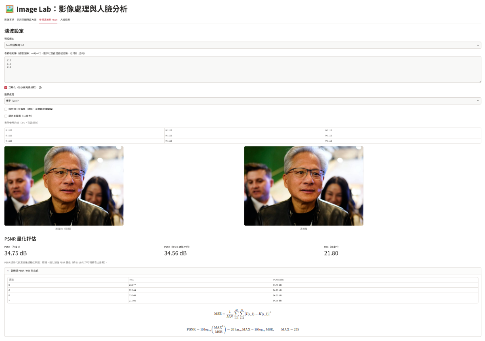{width=13cm}

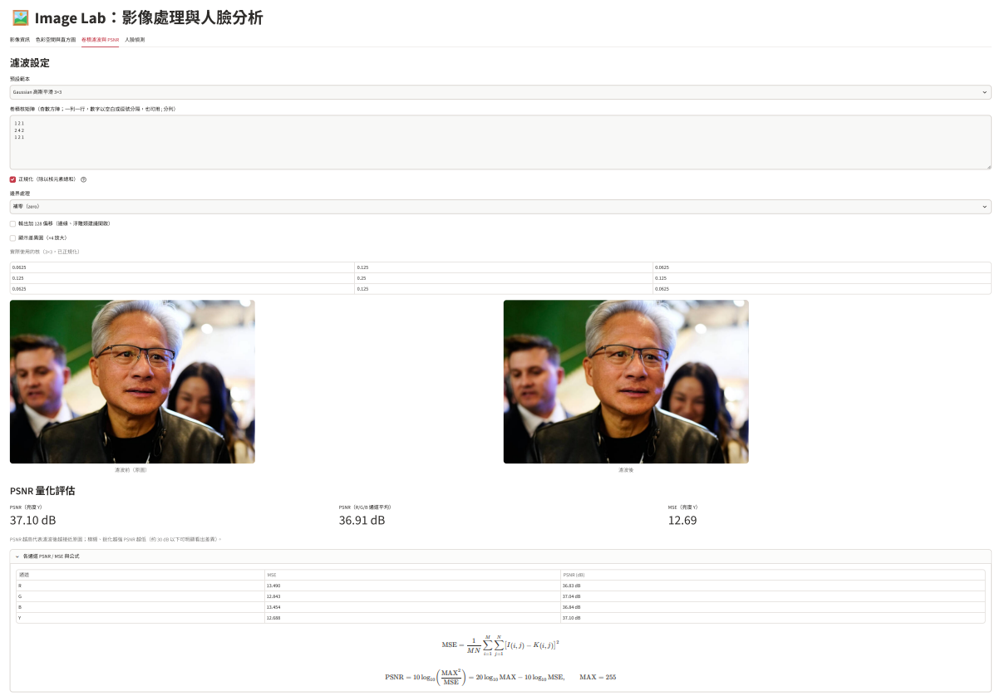{width=13cm}

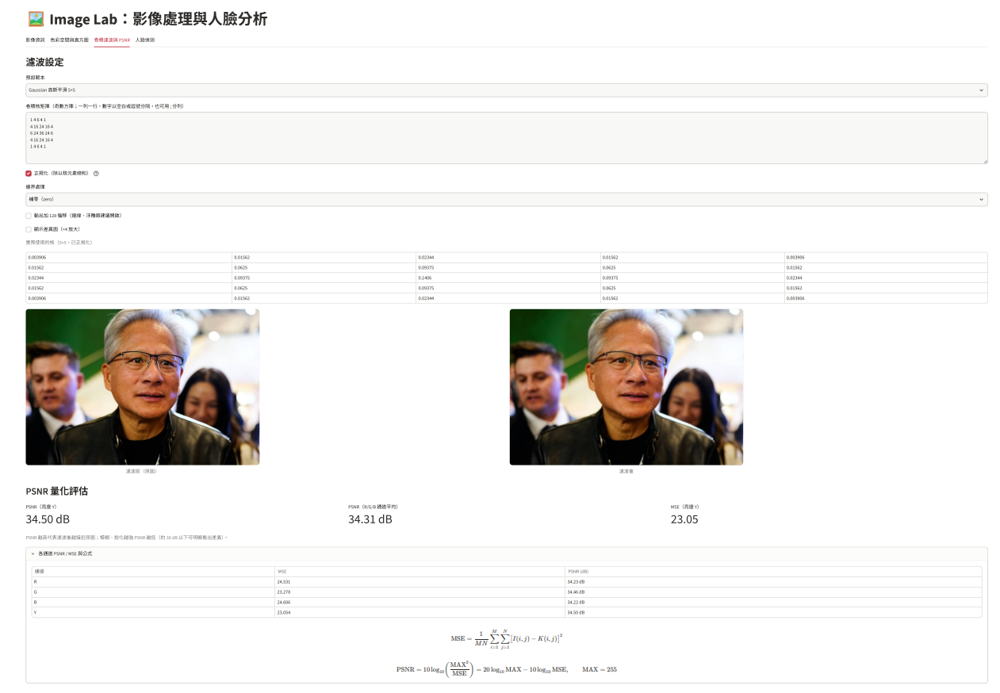{width=13cm}

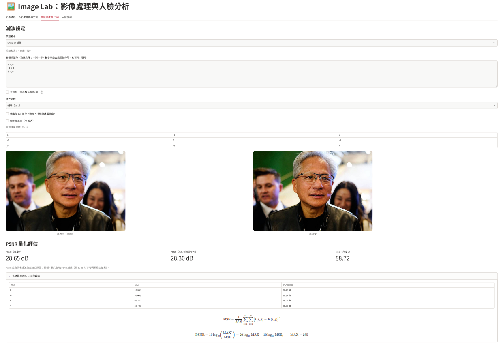{width=13cm}

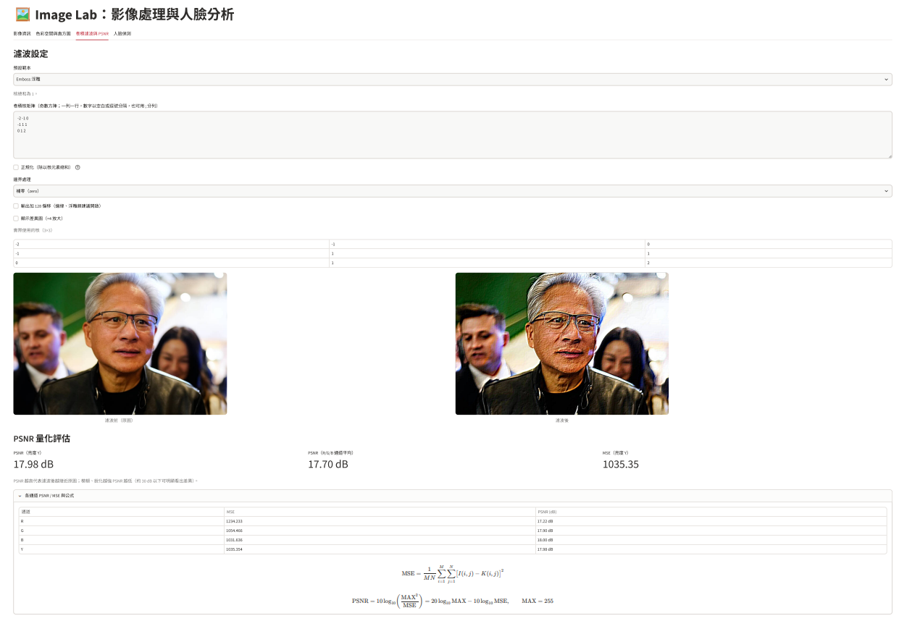{width=13cm}

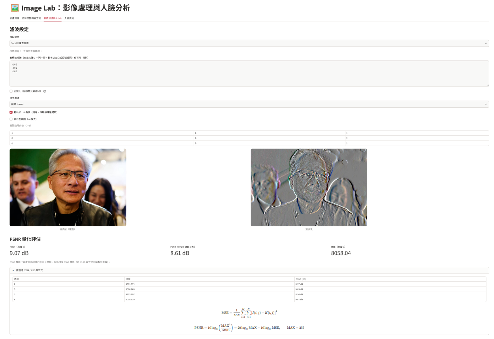{width=13cm}

{width=13cm}

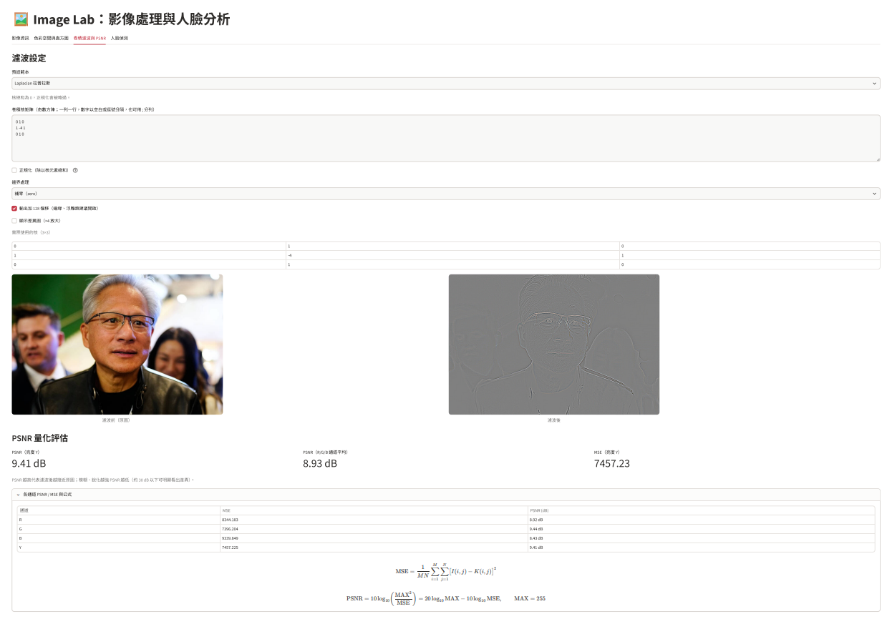{width=13cm}

### 4.3.4　邊界條件與輸入防呆

| 測試案例 | 預期行為 | 驗證方式 |
|:--------------------|:--------------------------|:------------------------|
| 非方陣（如 3×4） | 顯示「必須是方陣」，不執行運算 | `test_non_square_rejected`、圖 15 |
| 偶數尺寸（如 2×2、4×4） | 顯示「必須是奇數」（偶數沒有中心點） | `test_even_size_rejected`、圖 16 |
| 各列數字個數不同 | 指出第 1 列與出錯列的個數 | `test_ragged_rows_rejected` |
| 含非數字（如 `abc`） | 指出第幾列第幾格 | `test_bad_token_reports_position`、圖 17 |
| NaN、inf、1e999 | 拒絕：不是有限數值 | `test_nan_and_inf_rejected` |
| 空白輸入 | 提示請輸入核矩陣 | `test_empty_input` |
| 超過 15×15 的核 | 拒絕：核過大 | `test_too_large_rejected` |
| 核比影像還大 | 拒絕並說明 | `test_kernel_larger_than_image_rejected` |
| 全零核 | 警告：結果會是全黑 | `test_warnings` |
| 總和為 0 且勾選正規化 | 略過正規化並提示（不除以零） | `test_normalize_skips_zero_sum_kernel`、圖 18 |
| 原圖與濾波後完全相同（Identity） | MSE = 0，PSNR 顯示 ∞ | `test_identical_images_give_infinite_psnr`、圖 19 |
| 全形逗號、Unicode 負號、`;` 分列 | 正常解析 | `test_parse_fullwidth_characters` 等 |
| 與教科書定義逐元素對照 | 三種邊界、3×3 與 5×5 非對稱核皆一致 | `test_matches_naive_definition_with_asymmetric_kernels` |
| 與 OpenCV `filter2D` 對照 | 翻轉核後三種邊界皆一致（誤差 < 1e-9） | `test_matches_opencv_filter2d` |
| 輸出截斷與偏移 | 超過 255 截為 255、負值截為 0；偏移 128 正確 | `test_clipping_and_offset` |

**防呆介面實測**：以下 5 張為實際輸入錯誤或特殊核時的畫面。輸入有誤時，左側顯示明確的錯誤或警告訊息，右側提示先修正，程式不會當機。

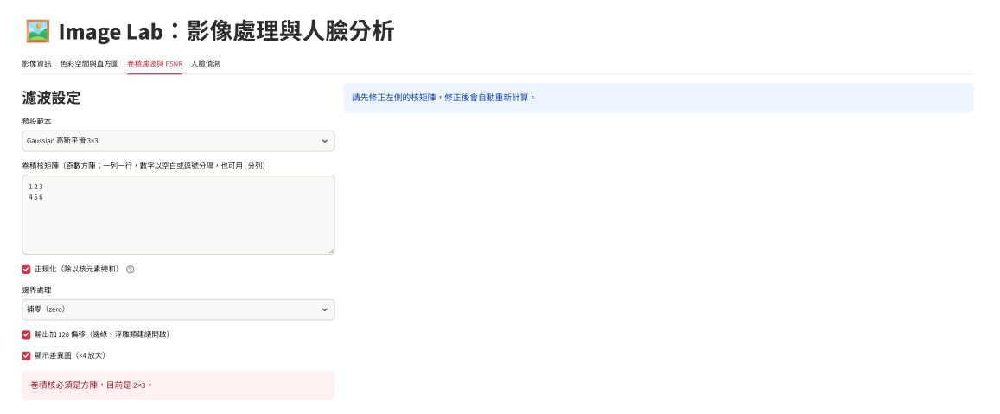{width=13cm}

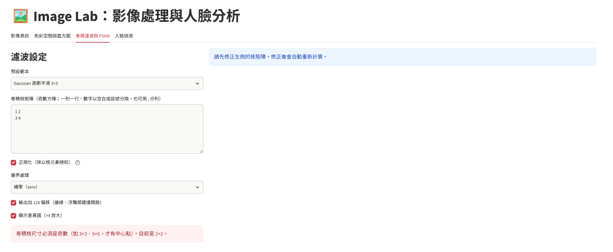{width=13cm}

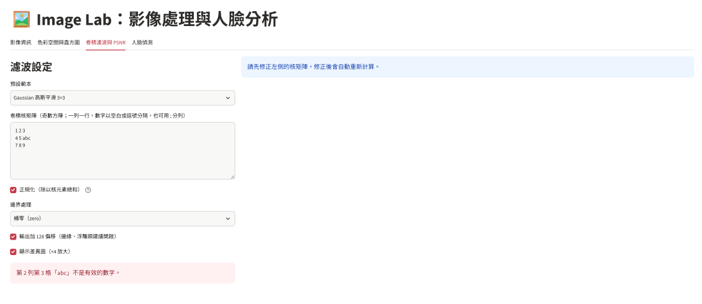{width=13cm}

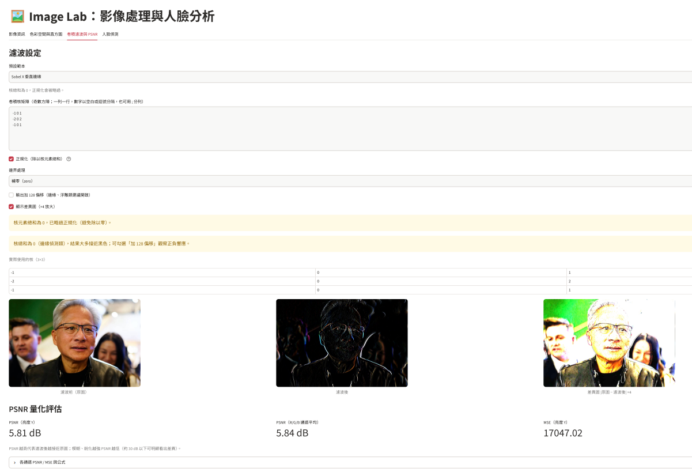{width=13cm}

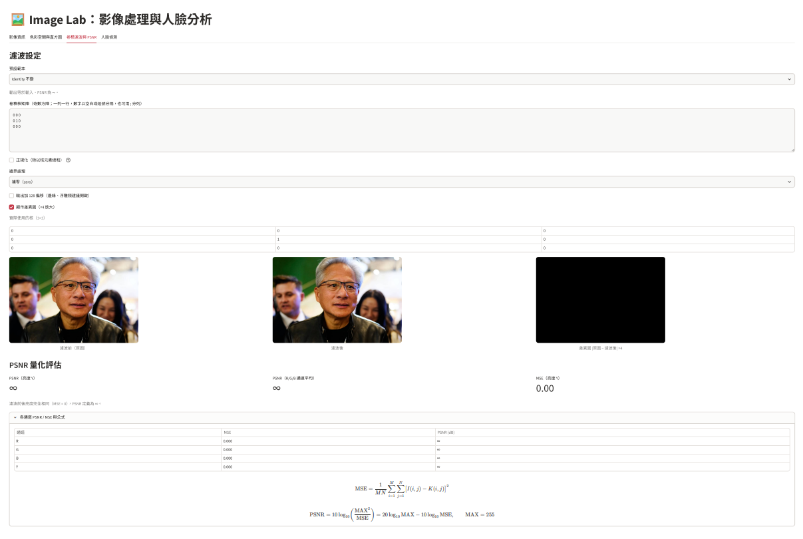{width=13cm}

## 4.4　功能 4：人臉偵測

### 4.4.1　演算法

採用 Viola–Jones 的 **Haar-Cascade**（OpenCV 內建的 `haarcascade_frontalface_default.xml`）：以 Haar-like 矩形特徵描述明暗對比；用**積分影像**使任一矩形和只需 4 次查表；以 AdaBoost 挑選特徵組成強分類器；再把多個強分類器串成**級聯（cascade）**，前面的簡單階段能快速排除大多數非人臉區域。偵測時在影像金字塔的多個尺度上以滑動視窗搜尋。

**可調參數**：`scaleFactor`（金字塔縮放比，越接近 1 越細也越慢）、`minNeighbors`（需要的鄰近候選框數，越大越嚴格）、最小人臉尺寸。

**信心度**：`detectMultiScale3(..., outputRejectLevels=True)` 會回傳每個框最後一層的**層級權重** $w$，它沒有上限、也不是機率。本專案以單調函數壓到 0–1：

$$\mathrm{confidence}=1-e^{-w/2}$$

並同時顯示原始權重。這是**啟發式正規化**，適合比較同一張影像中各框的相對可信度，不代表真實機率。

### 4.4.2　實測畫面

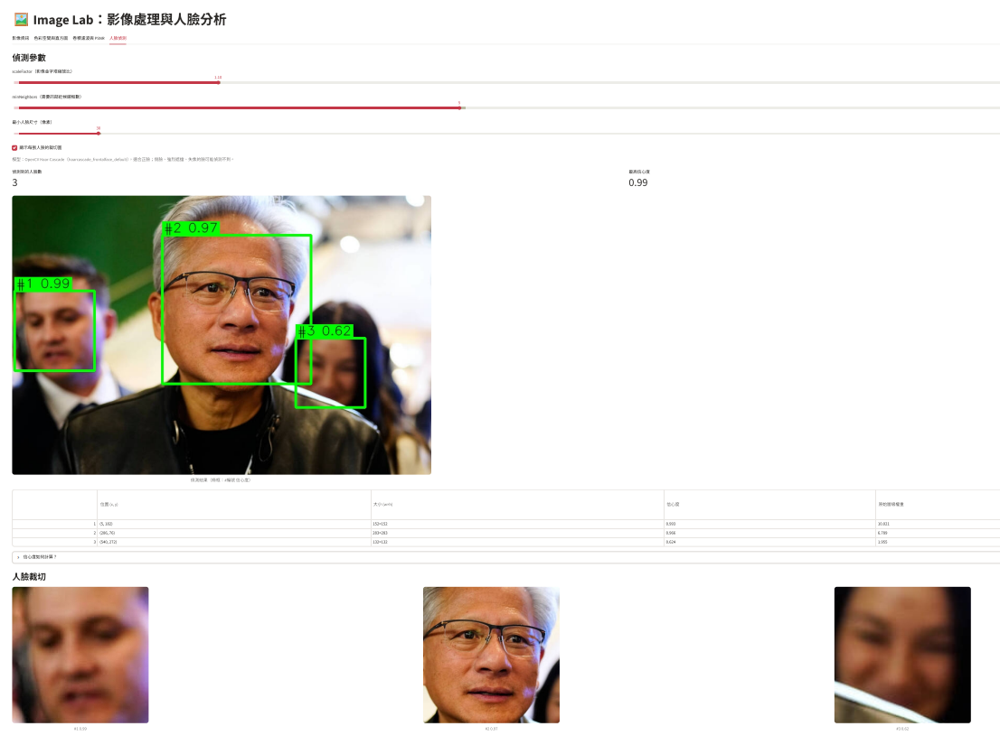{width=13cm}

【待補：偵測到的人臉數、各框信心度（請依圖 20 填寫）；以及 minNeighbors 調低／調高、最小人臉尺寸調大、無人臉影像、多人臉影像各一張截圖與觀察】

### 4.4.3　邊界條件

| 測試案例 | 預期行為 | 驗證方式 |
|:----------------------|:--------------------------|:------------------------|
| 全灰（無任何結構）的影像 | 偵測 0 張 | `test_flat_image_has_no_faces` |
| 比偵測視窗還小的影像（10×10、1×1） | 回傳空清單，不當機 | `test_tiny_image_returns_empty_without_crashing` |
| 最小人臉尺寸大於影像 | 回傳空清單 | `test_min_size_larger_than_image_returns_empty` |
| 參數不合法（scaleFactor ≤ 1、minNeighbors < 1、非 RGB uint8） | 拋出明確錯誤 | `test_parameter_validation` |
| 信心度範圍與單調性 | 落在 [0, 1) 且隨權重遞增 | `test_confidence_is_monotonic_and_bounded` |
| 畫框 | 不修改輸入影像；框貼近邊緣時標籤不超出影像 | `test_draw_*` |
| 超大影像（> 1280 像素） | 先縮小再偵測，框換算回原圖座標 | 實作於 `haar_detector.py` |
| 多人同時連線 | 對分類器加鎖，避免非執行緒安全造成當機 | 實作於 `haar_detector.py` |
| 多人臉、失焦、側臉 | Haar 以正臉為主，失焦或側臉可能漏偵測 | 【待補：以圖 20 與調參截圖說明】 |

### 4.4.4　單元測試

所有模組皆以 pytest 測試（`tests/`）：在開發機（Windows、Python 3.12）上的結果為 **71 個通過、1 個略過**（0 失敗）。略過的是選用的真實影像測試：`assets/samples/` 內沒有 `face*.jpg` 範例圖時會自動略過；其餘包含需要 Haar 模型的偵測測試皆通過。

# 5　PSNR 公式與濾波效果評估

## 5.1　公式推導

設原圖為 $I$、濾波後影像為 $K$，尺寸 $M\times N$，8-bit 影像的最大像素值 $\mathrm{MAX}=2^8-1=255$。

**步驟 1：均方誤差（MSE）**——每個像素差的平方取平均：

$$\mathrm{MSE}=\frac{1}{MN}\sum_{i=1}^{M}\sum_{j=1}^{N}\bigl[I(i,j)-K(i,j)\bigr]^{2}$$

**步驟 2：訊號功率與雜訊功率之比**——峰值訊號功率為 $\mathrm{MAX}^2$，雜訊功率為 $\mathrm{MSE}$，比值為 $\mathrm{MAX}^2/\mathrm{MSE}$。

**步驟 3：換成分貝**——功率比取 $10\log_{10}$：

$$\mathrm{PSNR}=10\log_{10}\!\left(\frac{\mathrm{MAX}^{2}}{\mathrm{MSE}}\right)=20\log_{10}\mathrm{MAX}-10\log_{10}\mathrm{MSE}\approx 48.13-10\log_{10}\mathrm{MSE}\ \text{(dB)}$$

**數值驗算**：$\mathrm{MSE}=1\Rightarrow 48.13$ dB；$\mathrm{MSE}=100\Rightarrow 10\log_{10}(65025/100)\approx 28.13$ dB；黑對白（$\mathrm{MSE}=65025$）$\Rightarrow 0$ dB；兩圖相同（$\mathrm{MSE}=0$）$\Rightarrow\infty$。MSE 每增為 2 倍，PSNR 減少 $10\log_{10}2\approx 3.01$ dB。

**幾何意義**：把影像看成 $\mathbb{R}^{MN}$ 中的向量，$\mathrm{MSE}=\lVert\mathbf{x}_I-\mathbf{x}_K\rVert_2^2/(MN)$，亦即兩影像在像素空間中歐氏距離平方的平均；PSNR 是這個距離經 $-10\log_{10}(\cdot)$ 轉換的結果，距離越近 PSNR 越高。

## 5.2　本專案的計算方式

- **逐通道**：對 R、G、B 分別計算 MSE 與 PSNR。
- **R/G/B 通道平均**：三個通道 PSNR（dB）的算術平均。
- **亮度 Y**：兩張影像先以 BT.601 轉成 Y（四捨五入為 uint8）再計算，較貼近人眼對明暗的感知。
- 先轉 float64 再相減，避免 uint8 溢位（例如 $0-255$ 在 uint8 會變成 $1$）；`test_no_uint8_wraparound` 驗證了這點。
- $\mathrm{MSE}=0$ 時定義 $\mathrm{PSNR}=\infty$，介面顯示「∞」。

## 5.3　各濾波器的實測結果

下表取自第 4.3.3 節各張畫面（同一張測試影像）。Y 的 PSNR 與 MSE 可互相換算驗證（例如 Box：$10\log_{10}(65025/21.80)=34.75$ dB）。

| 濾波器 | PSNR（亮度 Y） | PSNR（R/G/B 平均） | MSE（亮度 Y） | 效果 |
|:----------------|--------:|--------:|---------:|:-------------------------|
| Box 3×3 | 34.75 dB | 34.56 dB | 21.80 | 均勻模糊 |
| Gaussian 3×3 | 37.10 dB | 36.91 dB | 12.69 | 輕度模糊 |
| Gaussian 5×5 | 34.50 dB | 34.31 dB | 23.05 | 較強模糊 |
| Sharpen | 28.65 dB | 28.30 dB | 88.72 | 邊緣增強 |
| Emboss | 17.98 dB | 17.70 dB | 1035.35 | 浮雕、凹凸感 |
| Sobel X | 9.07 dB | 8.61 dB | 8058.04 | 垂直邊緣圖 |
| Sobel Y | 8.99 dB | 8.54 dB | 8203.78 | 水平邊緣圖 |
| Laplacian | 9.41 dB | 8.93 dB | 7457.23 | 二階邊緣圖 |

【待補：核對上表各項設定（邊界處理方式、是否勾選正規化／偏移），並確認 Gaussian 3×3 的數值（37.10 dB）與早先測得的 40.63 dB 為何不同】

## 5.4　客觀評估分析

1. **模糊類濾波器的 PSNR 約 34–37 dB**，屬於差異小、可接受的範圍。相同 3×3 大小下，Gaussian（37.10 dB）高於 Box（34.75 dB），因為高斯核把較大的權重放在中心，對原圖的改變較小；Box 把九個像素等權平均，模糊較重。
2. **核越大、模糊越強、PSNR 越低**：Gaussian 5×5（34.50 dB）低於 Gaussian 3×3（37.10 dB），因為 5×5 平均了更大範圍的像素，細節損失更多。
3. **銳化的 PSNR 較低（28.65 dB）**：銳化放大邊緣的高頻分量，與原圖的差異主要出現在邊緣，MSE 因此比輕度模糊大得多（可對照圖 10 的差異圖）。
4. **Emboss 與邊緣偵測類的 PSNR 很低（約 9–18 dB），但這不代表「品質差」**：這類濾波器的目的是產生浮雕或邊緣圖，輸出本來就不像原圖。以預設的 128 偏移為例，邊緣圖的大部分區域在 128 附近，與原圖亮度分布相差很大，所以 MSE 達數千。對這類濾波器，PSNR 只能說明「與原圖差多少」，不能當成「結果好不好」的指標。
5. **PSNR 的限制**：它逐像素比較數值差，不考慮人眼感知與結構（例如整張圖平移一格，視覺幾乎相同，PSNR 卻可能很低）。因此本報告同時提供並排對照與差異圖，作為量化數字之外的視覺佐證。
6. **證據範圍**：以上數值來自單一張測試影像；不同內容（平滑區域多寡、紋理多寡）會得到不同的 PSNR，絕對數值不宜直接類推到其他影像，但各濾波器之間的**相對大小關係**符合理論預期。

# 6　AI 協作與 Prompt 歷程

## 6.1　使用的模型

| 項目 | 內容 |
|:--------|:------------------------------------------|
| 模型 | Claude Sonnet 5.5（Anthropic） |
| 介面 | claude.ai，啟用檔案與 Shell 工具，並透過桌面應用程式存取專案資料夾 |
| 期間 | 2026-11-08 02:45 – 2026-11-09（Asia/Taipei） |
| 其他 AI 工具 | 【待補：如無請填「無」】 |

完整歷程見儲存庫 `prompt_log/`：每個階段依「原始 Prompt（逐字）→ AI 產出 → 問題 → Refinement → 結果 → 提示工程觀察」記錄，完整對話原文放在 `prompt_log/raw_exports/`。

## 6.2　協作流程

| 階段 | 使用者 Prompt 的策略 | AI 的產出 |
|:----------|:------------------------------|:------------------------------|
| 規劃（P1–P3） | 設定角色、要求「先不做任何動作」；貼上評分表與繳交規範；逐題回答確認問題 | 目錄結構、評分對應表、防呆清單；僅規劃、未建立檔案 |
| 環境檢查（P4–P5） | 授權 AI 直接檢視專案資料夾 | 發現 OpenCV 5.x 沒有 Haar，在寫程式前先修正 |
| 實作（P5–P8） | 先短指令（「請遵守規則，並且繼續實作」），再用截圖回報；使用條件式指令（「有問題就修正，無問題就繼續」） | io／color／直方圖、卷積／PSNR／防呆、人臉偵測與測試 |
| 部署（P9–P14） | 直接貼上終端機輸出 | README、Git 與 Streamlit Cloud 疑難排解 |

## 6.3　AI 的失誤與修正

| # | 問題 | 發現方式 | 修正 |
|:--|:----------------------------|:--------------------|:----------------------------|
| 1 | AI 假設使用者會裝到 OpenCV 4.x，建議只做 Haar；實際裝到 5.0.0.93，沒有 Haar | AI 檢視專案資料夾 | 降版為 `opencv-python-headless<5` |
| 2 | 規劃的 `src/` 版面在實作時改為根目錄 `imagelab/` | AI 自行判斷（部署與 pytest 較單純） | 回覆中說明差異與理由 |
| 3 | 直方圖中文標題顯示為方框 | 使用者截圖 | 自動偵測中文字型、無字型時退回英文、加入 `packages.txt` |
| 4 | AI 的執行環境無法執行 Windows 虛擬環境、Streamlit 與 Haar | 驗證時發現 | 以替身測試執行器驗證演算法，並明確告知未驗證的部分，由使用者本機實跑 |
| 5 | 指令中的 `<你的帳號>` 占位符被原樣貼入 `git remote` | 使用者貼上錯誤輸出 | `git remote set-url` 修正 |
| 6 | AI 無法連線 GitHub、網頁查詢受限 | 診斷 `Repository not found` 時 | 提供讓使用者自行判斷的對照表，不假裝已驗證 |

這些失誤的共同點是「**預設值未經確認就被使用**」，修正方式都是先檢查實際狀態再下指令。

# 7　結論與已知限制

**結論**：本專案完成四大功能，並以介面層與演算法層分離、完整的輸入防呆、對照 OpenCV 的卷積驗證、PSNR 公式推導與實測分析，滿足作業要求；線上展示與原始碼皆為公開。

**已知限制**

- Haar-Cascade 以正臉為主，側臉、嚴重遮擋或失焦的臉可能偵測不到；信心度為啟發式正規化，不是機率。
- PSNR 只反映像素差，不反映人眼感知與結構相似度。
- 影像上限 2500 萬像素；超大影像卷積會較慢（約 2000 萬像素、5×5 核約 3 秒）。
- 實測以單一測試影像為主，結論的相對關係具參考性，絕對數值不宜直接類推。

**未來工作**：加入 SSIM 等結構相似度指標；加入深度學習偵測器（如 MediaPipe）並與 Haar 比較；支援同時檢視多種濾波結果。

# 參考資料

1. P. Viola and M. Jones, "Rapid Object Detection using a Boosted Cascade of Simple Features," CVPR, 2001.
2. ITU-R Recommendation BT.601, *Studio encoding parameters of digital television for standard 4:3 and wide-screen 16:9 aspect ratios*.
3. R. C. Gonzalez and R. E. Woods, *Digital Image Processing*, Pearson.
4. OpenCV Documentation：`cv::CascadeClassifier`、`cv::filter2D`。
5. Streamlit Documentation：https://docs.streamlit.io
